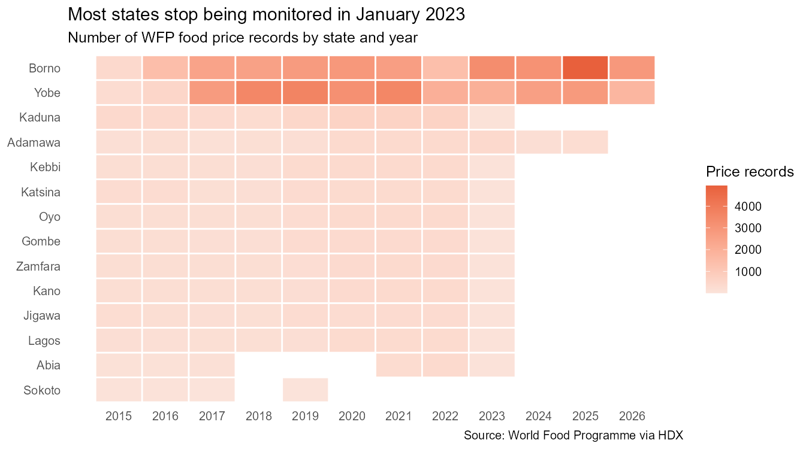
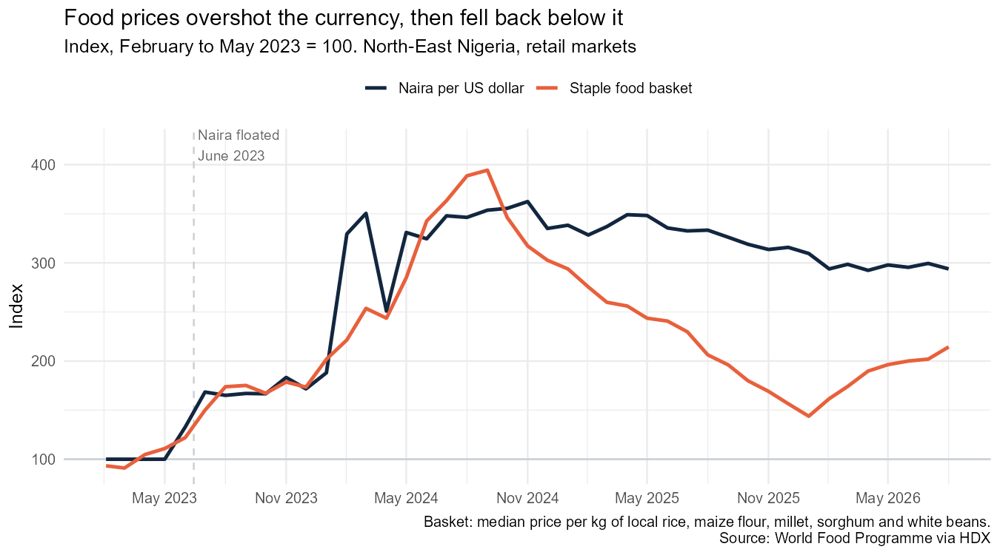
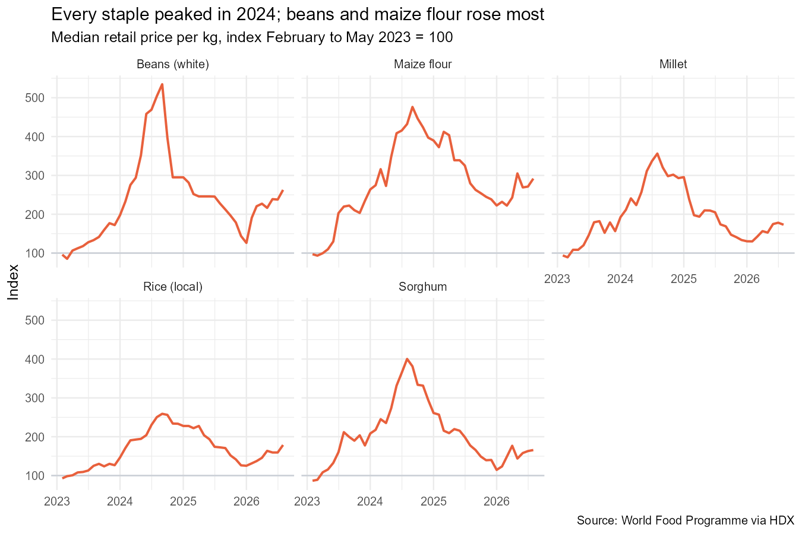

# Food prices in North-East Nigeria after the naira float

**After the naira was floated in June 2023, staple food prices in North-East Nigeria rose faster than the currency fell: by September 2024 a basket of five staples cost 3.9 times its early-2023 level, while a dollar cost 3.5 times as many naira. Prices then fell back sharply, and in January 2026 the basket cost less than half (46%) of its early-2023 price in dollar terms.**

**Tools:** R (readr, dplyr, tidyr, stringr, lubridate, ggplot2), Quarto

**Data:** [World Food Programme market prices for Nigeria](https://data.humdata.org/dataset/wfp-food-prices-for-nigeria), via the Humanitarian Data Exchange; 88,391 price records, 2002 to 2026, downloaded 31 October 2026

**Read the full report:** [ayanfedara.github.io/nigeria-food-prices/food_prices.html](https://ayanfedara.github.io/nigeria-food-prices/food_prices.html) | **Code:** [`food_prices.qmd`](food_prices.qmd) | **Clean data:** [`data/clean/ne_retail_prices_clean.csv`](data/clean/ne_retail_prices_clean.csv)

---

## Business question

In June 2023 Nigeria let the naira float. How much did staple food prices rise in North-East Nigeria, did they follow the currency, and where do they stand now?

## Cleaning

The raw file holds 88,391 prices from 68 markets in 14 states. Before it could answer the question:

| Problem in the raw data | What I did |
| --- | --- |
| Prices recorded in 20 different units, from 100 kg sacks and 2.6 kg bowls to 400 g tins and "30 pcs" of eggs | Split each unit into size and measure with `stringr`, converted grams to kilograms, and divided every price by its quantity to get a price per kg, litre or piece |
| 11 of the 14 states stop being monitored in January 2023, and Adamawa in November 2025 | Showed the gap with a coverage chart and limited the analysis to the three North-East states, Borno, Yobe and Adamawa |
| WFP's recording method changes from "actual" to "aggregate" prices over 2020 to 2024 | Checked that the two flags never overlap for the same price (0 duplicates), so both were kept |
| HDX files can carry a second header row of tags | Read every column as text, removed any tag row, then converted types (none present in this download) |
| No exchange rate column | Derived the rate WFP used from each price in naira and in dollars |
| 152 implausible prices (0.34%), mostly fish, spinach and powdered milk | Flagged prices over 5 times or under a fifth of the median for that food and month, and left them out of the medians instead of deleting them |
| Last month incomplete | Stopped at August 2026, the last complete month |

The result is a tidy file of 44,802 retail prices from 52 markets and 38 foods, January 2019 to August 2026, documented below.

## Findings

With February to May 2023 (the four months before the float) set to 100:

| Month | Staple basket | Naira per US dollar | Basket in dollar terms |
| --- | --- | --- | --- |
| May 2023 | 111 | 100 | 111 |
| September 2024 (peak) | **394** | 354 | 112 |
| January 2026 | 144 | 310 | **46** |
| August 2026 | 214 | 294 | 73 |

### 1. Food prices overshot the currency

The basket (local rice, maize flour, millet, sorghum and white beans) reached 394 in September 2024, almost four times its pre-float level, while the naira price of a dollar reached 354.

### 2. Then they fell back below it

By January 2026 the basket had fallen to 144 while a dollar still cost 3.1 times as many naira, so in dollar terms food cost less than half of what it did before the float. Prices have risen again since, to 214 in August 2026.

### 3. Beans and maize flour rose most

Every staple peaked in August or September 2024. White beans peaked at 535 and maize flour at 476; local rice rose least, to 259.

**What it means:** for families who earn in naira, staples still cost about twice what they did in early 2023. For aid agencies that buy food with dollars, the same food is now cheaper than before the float.

## Clean dataset

`data/clean/ne_retail_prices_clean.csv`: one row per market, food and date; retail prices in Borno, Yobe and Adamawa, January 2019 to August 2026.

| Column | Meaning |
| --- | --- |
| `date`, `month` | Date of the price, and the first day of its month |
| `state`, `lga`, `market` | Where the price was recorded |
| `category`, `commodity` | WFP food group and food |
| `unit_recorded` | The measure the price was recorded in, as in the raw data (for example `2.6 KG`) |
| `quantity`, `per` | That measure converted to kg, litres or pieces |
| `price_ngn` | Price for the recorded measure, in naira |
| `price_per_unit_ngn` | Price per kg, litre or piece, in naira |
| `price_usd` | WFP's US dollar price for the recorded measure |
| `ngn_per_usd` | Exchange rate implied by the two prices |
| `price_flag` | WFP's flag: `actual`, `aggregate` or both |
| `outlier` | TRUE if the price is over 5 times or under a fifth of the median for that food and month |

## Limitations

- Only the North-East is monitored after January 2023; the region's conflict affects prices for its own reasons, so the results do not describe Nigeria as a whole.
- The number of markets reporting changes from month to month (5 to 38), so part of the movement comes from which markets reported.
- The exchange rate is the one WFP used, which may differ from the official or parallel market rate.
- WFP revises its file over time; a later download may give slightly different numbers.

## How to run it

See [GUIDE.md](GUIDE.md). Download `wfp_food_prices_nga.csv` from HDX into `data/raw/`, open `nigeria-food-prices.Rproj` in RStudio, and render `food_prices.qmd`.

---

Olorunmaiye Peter | [Portfolio](https://ayanfedara.github.io)
